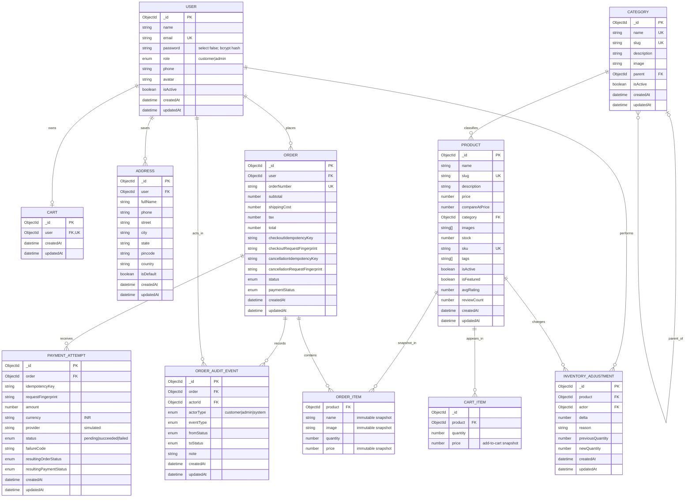

# ShopSphere entity-relationship diagram

The diagram reflects the Mongoose models under `server/src/models`. References are MongoDB `ObjectId` relationships; embedded values are shown inside their owning document.

## Important indexes

- `User`: unique `email`; `role`.
- `Category`: unique `name` and `slug`; `parent`.
- `Product`: unique `slug` and `sku`; `category`; `price`; text index on `name`, `tags`, `description`; `(isActive, isFeatured)`; `createdAt`.
- `Cart`: unique `user`.
- `Address`: `user`.
- `Order`: `(user, createdAt desc)`; `(status, paymentStatus, createdAt desc)`; unique partial `(user, checkoutIdempotencyKey)`; unique partial `(user, cancellationIdempotencyKey)`.
- `PaymentAttempt`: unique `(order, idempotencyKey)`; `(order, createdAt desc)`.
- `OrderAuditEvent`: `(order, createdAt desc)`; `(eventType, createdAt desc)`.
- `InventoryAdjustment`: `(product, createdAt desc)`; `(actor, createdAt desc)`.
